# AOFA Website Administration Manual
### Association of Former BCS(FA) Ambassadors (AOFA)
**A Simple, Non-Technical Guide to Updating and Managing the Website**

---

> **Who is this manual for?**  
> This guide is specially created for AOFA executive committee members, office managers, and administrative staff who manage the website content. **No coding or technical background is required.** Every task can be completed using simple forms, buttons, and typing in your web browser.

---

## Table of Contents
1. [Quick Reference Cheat Sheet](#quick-reference-cheat-sheet)
2. [Chapter 1: Getting Started & Logging In](#chapter-1-getting-started--logging-in)
   - [1.1 How to Access the Admin Portal](#11-how-to-access-the-admin-portal)
   - [1.2 Touring the Dashboard (Your Control Center)](#12-touring-the-dashboard-your-control-center)
   - [1.3 Resetting Your Password](#13-resetting-your-password)
   - [1.4 Logging Out Safely](#14-logging-out-safely)
3. [Chapter 2: Editing Website Pages & Text](#chapter-2-editing-website-pages--text)
   - [2.1 Finding the Page You Want to Edit](#21-finding-the-page-you-want-to-edit)
   - [2.2 Understanding the Visual Block Editor](#22-understanding-the-visual-block-editor)
   - [2.3 Formatting Text (Headings, Bold, Bullet Points)](#23-formatting-text-headings-bold-bullet-points)
   - [2.4 Adding Clickable Web Links](#24-adding-clickable-web-links)
   - [2.5 Saving and Publishing Your Changes](#25-saving-and-publishing-your-changes)
4. [Chapter 3: Managing Media & PDF Documents](#chapter-3-managing-media--pdf-documents)
   - [3.1 The Media Library Overview](#31-the-media-library-overview)
   - [3.2 Uploading Photos and PDFs](#32-uploading-photos-and-pdfs)
   - [3.3 Creating "Download Document" Links or Buttons](#33-creating-download-document-links-or-buttons)
   - [3.4 Image Sizing & Best Practices](#34-image-sizing--best-practices)
5. [Chapter 4: Managing Custom AOFA Content](#chapter-4-managing-custom-aofa-content)
   - [4.1 Members Directory (Regular & Honorary Ambassadors)](#41-members-directory-regular--honorary-ambassadors)
   - [4.2 Executive Committee (EC Roster by Term)](#42-executive-committee-ec-roster-by-term)
   - [4.3 Official Notices & Circulars](#43-official-notices--circulars)
   - [4.4 Articles & Book Reviews](#44-articles--book-reviews)
   - [4.5 Photo Gallery & Event Albums](#45-photo-gallery--event-albums)
6. [Chapter 5: Managing the Navigation Menu](#chapter-5-managing-the-navigation-menu)
   - [5.1 Opening the Menu Editor](#51-opening-the-menu-editor)
   - [5.2 Adding New Links to the Menu](#52-adding-new-links-to-the-menu)
   - [5.3 Reordering and Creating Drop-down Sub-menus](#53-reordering-and-creating-drop-down-sub-menus)
   - [5.4 Saving Menu Changes](#54-saving-menu-changes)
7. [Chapter 6: User Accounts & Security](#chapter-6-user-accounts--security)
   - [6.1 Adding a New Staff User](#61-adding-a-new-staff-user)
   - [6.2 Changing Your Name and Password](#62-changing-your-name-and-password)
   - [6.3 Security Do's and Don'ts](#63-security-dos-and-donts)
8. [Chapter 7: Frequently Asked Questions & Troubleshooting](#chapter-7-frequently-asked-questions--troubleshooting)

---

## Quick Reference Cheat Sheet

| Task | Where to Go in Left Sidebar | Key Action / Button |
| :--- | :--- | :--- |
| **Edit Page Text (About, Contact, etc.)** | **Pages** &rarr; **All Pages** | Click the page title, edit text, click **Update** |
| **Add a New Ambassador** | **Members** &rarr; **Add New Member** | Enter name, fill Member Details box, click **Publish** |
| **Update EC Committee List** | **Executive Committee** &rarr; **Add New EC Member** | Enter name, position, serial, check Term box, click **Publish** |
| **Post an Official Notice** | **Notices** &rarr; **Add New Notice** | Enter title, announcement text, upload PDF, click **Publish** |
| **Publish an Article / Book Review** | **Articles & Books** &rarr; **Add New Article** | Enter title, author, publication, select language, click **Publish** |
| **Add Photos to Gallery** | **Photo Gallery** &rarr; **Add New Photo** | Click **Select / Upload Multiple Photos**, click **Publish** |
| **Upload a PDF or Document** | **Media** &rarr; **Add Media File** | Drag and drop file, copy link to clipboard |
| **Change Navigation Menu** | **Appearance** &rarr; **Menus** | Drag and drop items into order, click **Save Menu** |

---

## Chapter 1: Getting Started & Logging In

### 1.1 How to Access the Admin Portal
To manage the website, you need to sign in to the administration portal using any modern web browser (Google Chrome, Microsoft Edge, Mozilla Firefox, or Apple Safari).

1. Open your web browser.
2. In the browser address bar, enter the admin web address:
   - **Live Website Address:** `https://aofabd.org/wp-admin`  
   *(If testing on your local development environment, use `http://localhost:8080/wp-admin`)*
3. You will see the AOFA login screen:

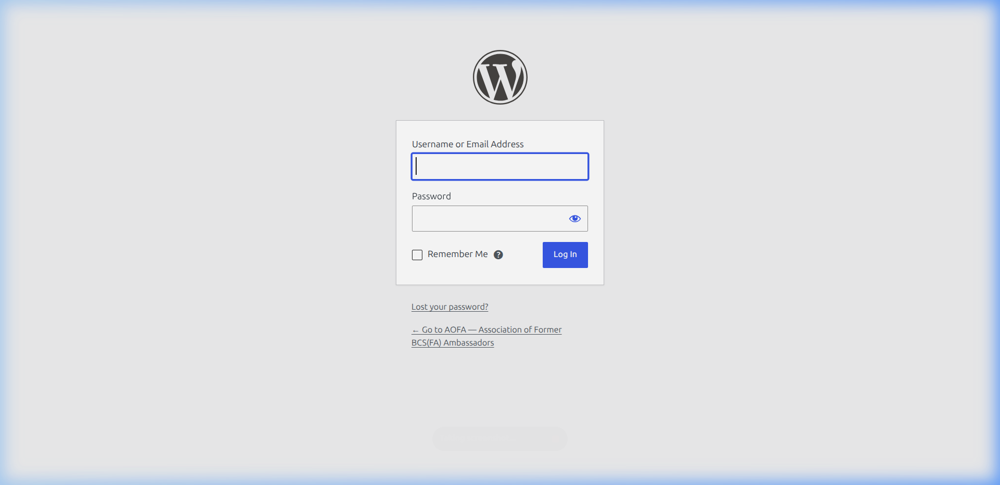

4. Enter your assigned **Username or Email Address** into the first box.
5. Enter your **Password** into the second box.
6. *(Optional)* Check the box labeled **"Remember Me"** if you are on your personal, trusted computer.
7. Click the blue **Log In** button.

---

### 1.2 Touring the Dashboard (Your Control Center)
Once you log in, you will be greeted by the **WordPress Admin Dashboard**.

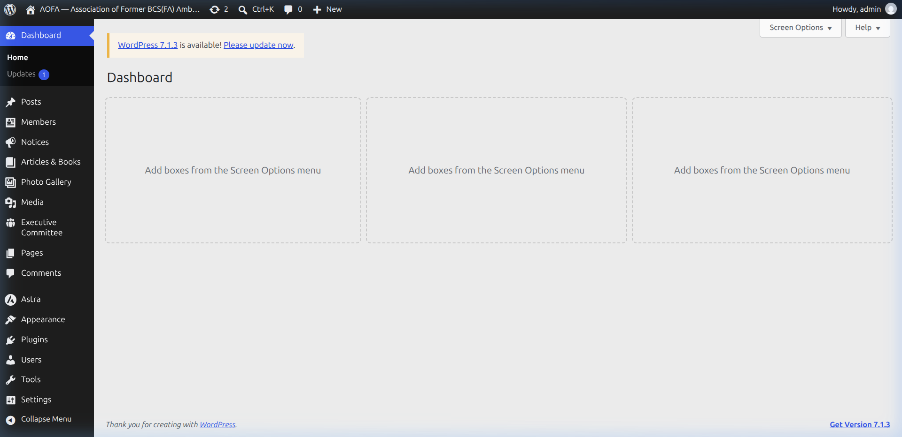

The dashboard is divided into three main areas:
1. **The Left Sidebar (Dark Charcoal Navigation):**  
   This is your main command center. Every section of the website (Members, Notices, Articles, Pages, Photo Gallery, Menus) has its own dedicated menu tab here. Clicking any item opens its management screen.
2. **The Top Black Bar (Admin Bar):**  
   Contains a quick link with a home icon labeled **"AOFA — Association of Former BCS(FA) Ambassadors"**. Clicking this allows you to view the public website as your visitors see it. On the far right is your account name (**"Howdy, admin"**), where you can log out.
3. **The Main Working Area (Center):**  
   This is where your forms, tables, and editors appear when you select an option from the sidebar.

---

### 1.3 Resetting Your Password
If you ever forget your password:
1. Visit the login page (`https://aofabd.org/wp-admin`).
2. Click the link below the login box that says **"Lost your password?"**.
3. Type your registered email address and click **"Get New Password"**.
4. Check your email inbox for an automated reset link, click it, and type a new secure password.

---

### 1.4 Logging Out Safely
When you are finished updating the website, always log out to protect the site:
1. Move your mouse to the top right corner over **"Howdy, [Your Name]"**.
2. In the dropdown menu that appears, click **Log Out**.

---

## Chapter 2: Editing Website Pages & Text

### 2.1 Finding the Page You Want to Edit
The AOFA website has several static informational pages such as **Home**, **About AOFA**, **Constitution**, **Messages**, and **Contact Us**.

1. In the left sidebar, click **Pages** &rarr; **All Pages**.
2. You will see a complete list of all website pages:

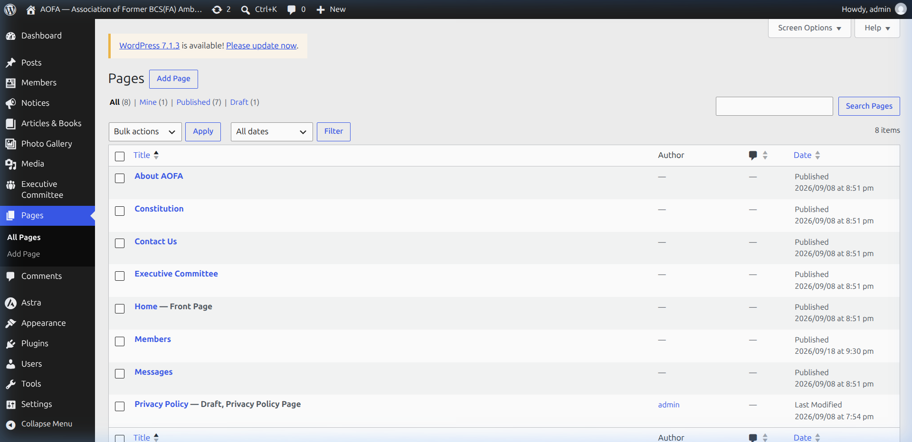

3. Hover your mouse over the title of the page you wish to edit (for example, **"About AOFA"** or **"Contact Us"**).
4. Click either the **page title** or the **"Edit"** link that appears beneath it.

---

### 2.2 Understanding the Visual Block Editor
When you open a page, WordPress presents the **Visual Block Editor**. Think of this like Microsoft Word or Google Docs built into the web. Every piece of content (a paragraph, a heading, an image) is a separate "block".

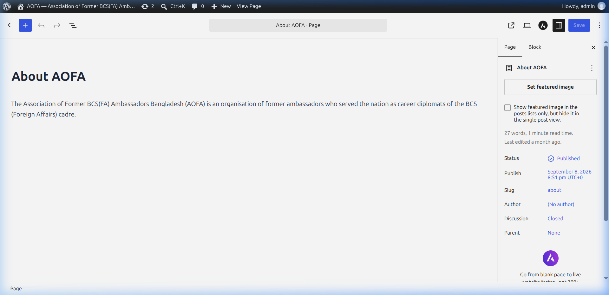

Key parts of the editor:
- **Title Box (Top):** The main headline of the page.
- **Content Area (Middle):** Click anywhere inside the text to start typing, editing, or deleting words directly.
- **Plus Icon (+) (Top Left):** Click this button whenever you want to insert a new element (such as a Heading, Image, List, or Paragraph).
- **Settings Sidebar (Right Side):** Shows settings for the entire page or whichever specific block you currently have selected.
- **Blue Save / Update Button (Top Right):** Saves your work and updates the live website immediately.

---

### 2.3 Formatting Text (Headings, Bold, Bullet Points)
Formatting text is straightforward:

#### Editing existing text:
1. Click your mouse cursor directly into the sentence you want to change.
2. Use your keyboard's Backspace or Delete key and type your new text.

#### Changing text to Bold or Italic:
1. Highlight the words with your mouse.
2. A small floating toolbar will appear immediately above your selection.
3. Click **B** for **Bold** or *I* for *Italic*.

#### Adding a Bulleted or Numbered List:
1. Click the **(+)** button at the top left (or type `/list` on a new line).
2. Select **List**.
3. Type your first bullet item and press **Enter** on your keyboard to create the next bullet.

#### Adding a Section Heading:
1. Click the **(+)** button.
2. Select **Heading**.
3. Type your section heading (e.g., *"Our Mission and Objectives"*).
4. In the floating toolbar, you can choose H2 (major section) or H3 (sub-section).

---

### 2.4 Adding Clickable Web Links
To turn any word or phrase into a clickable link:
1. Highlight the text you want to make clickable (e.g., *"Read the Full Statement"* or *"Ministry of Foreign Affairs"*).
2. On the floating toolbar, click the **Link icon** (resembles a chain link &infin;).
3. Type or paste the destination web URL (for example: `https://mofa.gov.bd`).
4. Press **Enter** on your keyboard.
5. If the link points to an external website, toggle on the option **"Open in new tab"** so visitors don't lose the AOFA website.

---

### 2.5 Saving and Publishing Your Changes

> **Important:** Changes do not appear on the live website until you click the **Update** button!

1. When you are done editing, look at the top right corner of your screen.
2. Click the blue **Update** (or **Save**) button.
3. A confirmation message *"Page updated"* will appear at the bottom left of your screen.
4. To check how your changes look on the live site, click **"View Page"** in the top black bar.

---

## Chapter 3: Managing Media & PDF Documents

### 3.1 The Media Library Overview
The **Media Library** stores all uploaded files, including photographs, logos, banners, event galleries, and downloadable PDF documents.

1. In the left sidebar, click **Media** &rarr; **Library**.
2. You will see a grid of all images and files currently on your website:

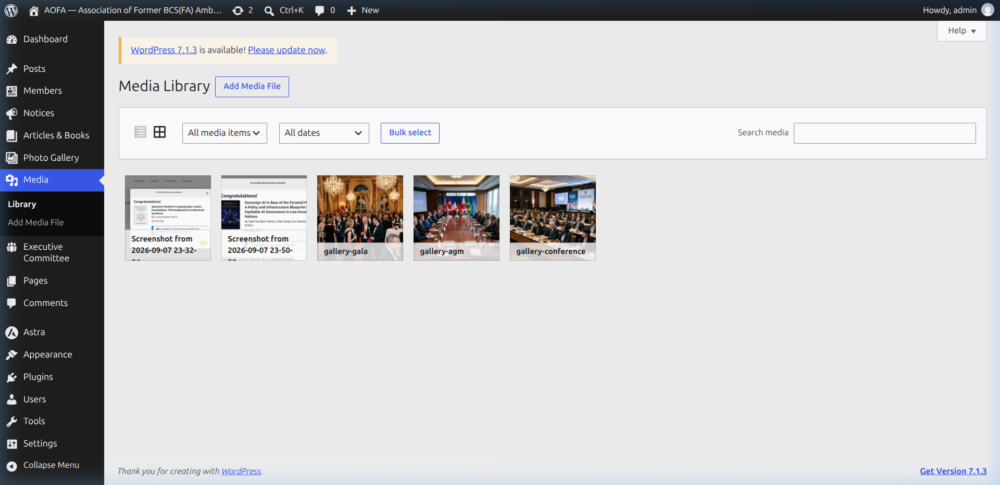

---

### 3.2 Uploading Photos and PDFs
You can upload any file in seconds:

1. In the left sidebar under **Media**, click **Add Media File** (or click the **"Add Media File"** button at the top of the Media Library).
2. Either:
   - Drag files from your computer folder directly onto the dashed box, **OR**
   - Click the button **"Select Files"**, browse to the photo or PDF file on your computer, and click **Open**.
3. The upload progress bar will run. Once complete, your new file is ready to use!

---

### 3.3 Creating "Download Document" Links or Buttons
A common task is sharing an official document (such as the AOFA Constitution PDF, Annual Financial Report, or an Executive Circular):

#### Step 1: Get the Document Link
1. Go to **Media** &rarr; **Library**.
2. Click on the uploaded PDF file to open its details window.
3. On the right side, find the box labeled **"File URL"**.
4. Click the button **"Copy URL to clipboard"**. (This copies the direct web link to the PDF).

#### Step 2: Attach it to a Page or Notice
1. Open the page or notice where you want the download link to appear (e.g., the *Constitution* page).
2. You can create either a text link or a prominent button:
   - **For a text link:** Type *"Click here to download the AOFA Constitution (PDF)"*. Highlight that text, click the **Link icon**, paste the URL you copied, and press Enter.
   - **For a button:** Click the **(+)** button, search for **Buttons**, type *"Download PDF"*, click the Link icon on the button, and paste the URL.
3. Click **Update** to save the page. Visitors can now click to view or download the PDF document.

---

### 3.4 Image Sizing & Best Practices
To keep the AOFA website fast, crisp, and professional:
- **Formats:** Use standard JPG or PNG images.
- **File Size:** Try to keep images under **1 MB** (ideal size is between 200 KB and 600 KB). Very large photos straight from high-end cameras (e.g., 10 MB - 25 MB) will slow down the website for visitors on mobile connections.
- **Portraits (Ambassador Photos):** For member and EC photos, standard passport-style or vertical portrait ratios work best.
- **Resolution:** A width of 800px to 1200px is more than enough for sharp display on all screens.

---

## Chapter 4: Managing Custom AOFA Content

The AOFA website features custom content modules tailored specifically to diplomatic association operations. Each has its own dedicated dashboard section.

---

### 4.1 Members Directory (Regular & Honorary Ambassadors)
The AOFA website maintains a directory of all registered former BCS(FA) ambassadors, categorized as **Regular** or **Honorary** members.

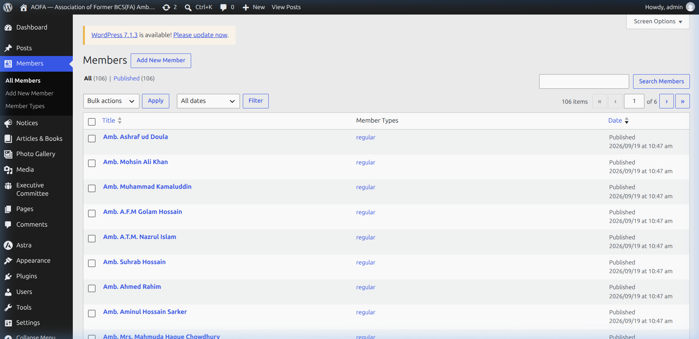

#### Viewing & Searching Members:
1. In the left sidebar, click **Members** &rarr; **All Members**.
2. You can search for any ambassador by typing their name in the search box at the top right and clicking **Search Members**.

#### Adding a New Ambassador:
1. In the left sidebar, click **Members** &rarr; **Add New Member**.
2. The member editor will open:

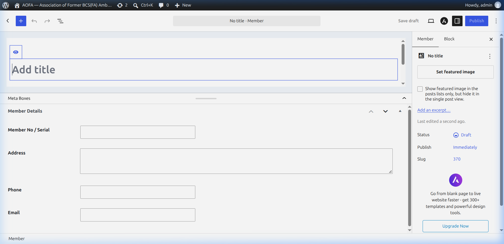

3. **Title Box:** Type the ambassador's full official title and name (e.g., `Amb. Dr. Muhammad Azizur Rahman`).
4. **Member Details Box (Below Editor):**
   - **Member No / Serial:** Enter the membership registration number (e.g., `107`).
   - **Address:** Enter the permanent or contact address in Dhaka/abroad.
   - **Phone:** Enter their primary telephone or mobile contact number.
   - **Email:** Enter their official or personal email address.
5. **Member Types (Right Sidebar):**
   - Look at the right sidebar panel labeled **Member Types**.
   - Check the box for either **regular** or **honorary**.
6. **Profile Photo (Right Sidebar):**
   - Click **"Set featured image"** on the right side.
   - Choose or upload the ambassador's official portrait photo.
7. Click the blue **Publish** button at the top right. The new member profile will immediately appear in the website directory!

#### Updating an Existing Member:
1. Go to **Members** &rarr; **All Members**.
2. Click on the ambassador's name.
3. Edit the address, phone number, or email in the **Member Details** box.
4. Click **Update** at the top right.

---

### 4.2 Executive Committee (EC Roster by Term)
The Executive Committee section showcases the leadership roster for each biennial term (e.g., 2022–2023, 2024–2025, 2026–2027).

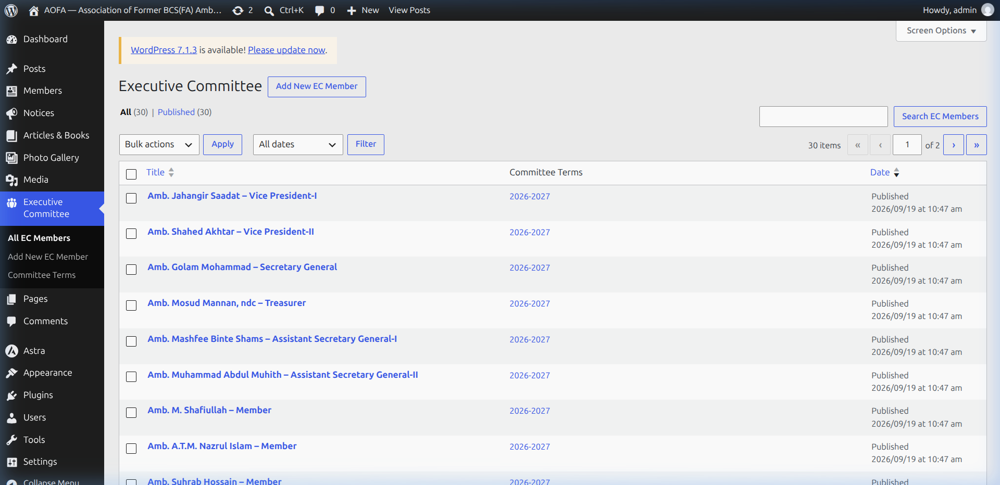

#### Adding or Updating an EC Member:
1. In the left sidebar, click **Executive Committee** &rarr; **Add New EC Member**.
2. **Title:** Type the Ambassador's name and role (e.g., `Amb. Jahangir Saadat – Vice President-I`).
3. **Executive Committee Details Box (Below Title):**
   - **Serial No:** Enter the order number (e.g., `1` for President, `2` for Vice President-I, `3` for Vice President-II, `4` for Secretary General, etc.). This ensures the leadership roster displays in proper diplomatic protocol order.
   - **Position:** Type the exact post title (e.g., `President`, `Secretary General`, `Treasurer`, `Executive Member`).
   - **Term:** Type the term year (e.g., `2026-2027`).
4. **Committee Terms (Right Sidebar):**
   - Under the **Committee Terms** box on the right sidebar, check the appropriate term (e.g., **2026-2027**).
5. **Photo:** Click **Set featured image** in the right sidebar to attach their official portrait.
6. Click the blue **Publish** button.

---

### 4.3 Official Notices & Circulars
The Notices section is used for official announcements, election schedules, AGM invitations, picnic circulars, and condolence messages.

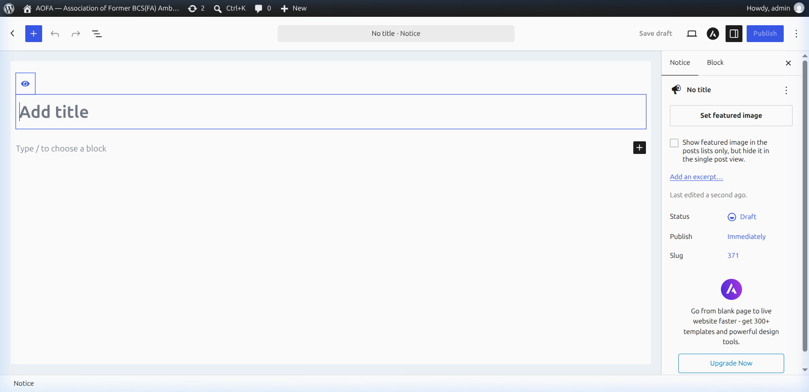

#### How to Post a Notice:
1. In the left sidebar, click **Notices** &rarr; **Add New Notice**.
2. **Title:** Type the notice headline (e.g., *"Notice of the 12th Annual General Meeting (AGM) 2026"*).
3. **Notice Text:** Click in the main content area and type or paste the announcement text.
4. **Attaching a PDF Notice:**
   - If you have an official signed PDF circular, upload it to the **Media Library**, copy its URL, and add a download button in the content (see [Chapter 3.3](#33-creating-download-document-links-or-buttons)).
5. **Featured Image (Optional):** If the notice has an accompanying flyer or photograph, click **Set featured image** in the right sidebar.
6. Click the blue **Publish** button. The notice will immediately appear on the website's Official Notices page and homepage notice board.

---

### 4.4 Articles & Book Reviews
The AOFA website hosts scholarly articles, geopolitical analyses, memoirs, and book reviews authored by former ambassadors.

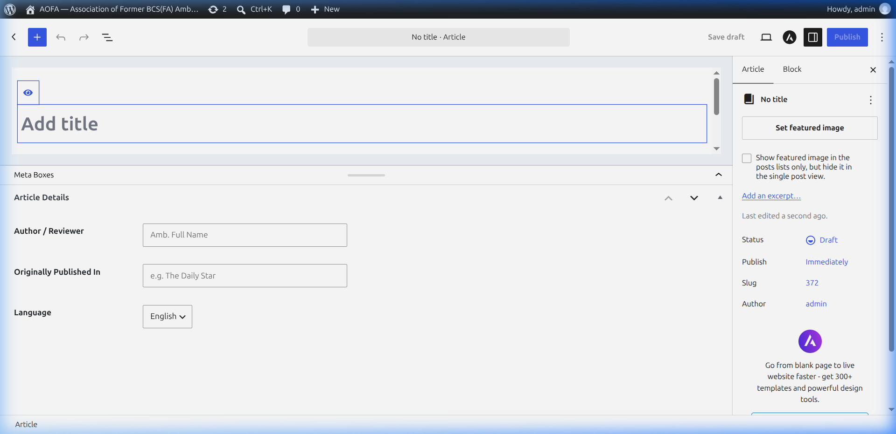

#### How to Publish an Article or Book Review:
1. In the left sidebar, click **Articles & Books** &rarr; **Add New Article**.
2. **Title:** Enter the title of the article or book review.
3. **Article Body:** Paste the full text of the article into the main content block.
4. **Article Details Box (Below Content):**
   - **Author / Reviewer:** Enter the author's full diplomatic title (e.g., `Amb. M. Humayun Kabir`).
   - **Originally Published In:** If published in an external newspaper or journal, enter the publication name (e.g., `The Daily Star` or `The Independent`). If unpublished, you may leave this blank.
   - **Language:** Select **English** or **Bengali** from the dropdown menu.
5. **Article Categories (Right Sidebar):**
   - Check either **Article** or **Book Review**.
6. **Featured Image / Book Cover:**
   - Click **Set featured image** on the right side to upload the book cover image or article illustration.
7. Click **Publish**.

---

### 4.5 Photo Gallery & Event Albums
The website includes an integrated gallery to showcase diplomatic receptions, annual picnics, delegations, and general assemblies.

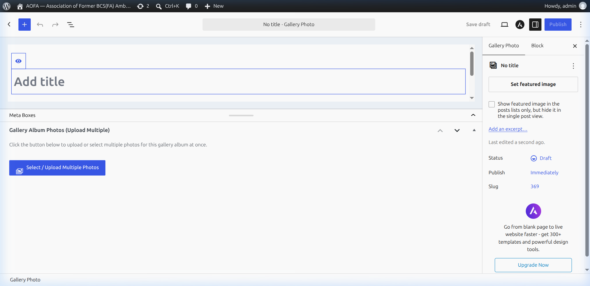

#### How to Create a New Photo Album:
1. In the left sidebar, click **Photo Gallery** &rarr; **Add New Photo**.
2. **Title:** Enter the event name (e.g., *"AOFA Annual Diplomatic Dinner 2026"*).
3. **Description (Optional):** Enter a brief description or date of the event in the main content area.
4. **Album Photos (Custom Multi-Uploader):**
   - Locate the **Gallery Album Photos (Upload Multiple)** box below the title.
   - Click the blue button labeled **"Select / Upload Multiple Photos"**.
   - In the popup window that appears, you can select multiple photos at once (hold `Ctrl` on Windows or `Cmd` on Mac while clicking photos, or drag a batch of new images from your computer).
   - Click **Select**.
   - Thumbnails of all selected photos will instantly appear in the album grid with small red delete (&times;) icons if you need to remove any picture.
5. **Cover Photo:** Click **Set featured image** on the right sidebar to select the main cover photo for this album.
6. Click **Publish**. The album is now live on the Photo Gallery page.

---

## Chapter 5: Managing the Navigation Menu

The navigation menu appears at the top of every page on the AOFA website, allowing visitors to easily navigate between sections.

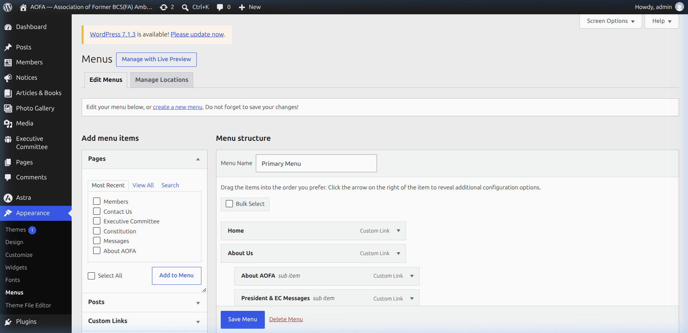

### 5.1 Opening the Menu Editor
1. In the left sidebar, click **Appearance** &rarr; **Menus**.
2. In the **"Select a menu to edit"** dropdown at the top, make sure **"Primary Menu"** is selected, and click **Select**.

---

### 5.2 Adding New Links to the Menu
To add an existing page to the menu:
1. Look at the left column labeled **"Add menu items"**.
2. Under **Pages**, click **"View All"**.
3. Check the box next to any page you want to add (e.g., *Members*, *Constitution*, *Contact Us*).
4. Click the button labeled **"Add to Menu"**.
5. The page will appear at the bottom of the right-hand **"Menu structure"** list.

---

### 5.3 Reordering and Creating Drop-down Sub-menus
You can rearrange menu items simply by dragging them with your mouse:

#### Reordering (Moving Up or Down):
1. Click and hold any menu card with your mouse.
2. Drag it up or down to your desired position.
3. Release the mouse button.

#### Creating a Dropdown Sub-menu (Child Item):
To place an item inside a dropdown under a main menu item (for example, putting *About AOFA* and *President's Message* under *About Us*):
1. Drag the item directly underneath the parent item.
2. **Drag it slightly to the right** until it indents.
3. Release the mouse button. The card will now show the label **`sub item`** (as seen in the screenshot above).

#### Changing the Display Name of a Menu Link:
1. Click the small downward arrow on the right side of any menu item card to expand it.
2. In the **Navigation Label** box, change the text (for example, change *"Members"* to *"Ambassadors Directory"*).
3. Click the arrow again to close the card.

---

### 5.4 Saving Menu Changes

> **Important:** Always click the blue **"Save Menu"** button at the bottom right after rearranging or adding menu items. If you navigate away without saving, your menu changes will be lost!

---

## Chapter 6: User Accounts & Security

### 6.1 Adding a New Staff User
If a new committee member or office assistant joins AOFA and needs access to edit the website:

1. In the left sidebar, click **Users** &rarr; **Add New User**.
2. Fill in the required fields:
   - **Username:** (e.g., `secretary_aofa`)
   - **Email:** The staff member's official email address.
   - **First Name & Last Name**
3. **Role Selection:**
   - **Administrator:** Full unrestricted access to all settings, plugins, themes, and users. Give this only to primary web administrators.
   - **Editor:** Can create, edit, and publish pages, posts, members, notices, and galleries, but cannot alter core system settings. **(Recommended for regular staff and committee members)**.
4. Click **"Add New User"**. An email will be sent inviting them to set their password.

---

### 6.2 Changing Your Name and Password
To update your personal login details:
1. In the left sidebar, click **Users** &rarr; **Profile**.
2. Scroll down to:
   - **Display name publicly as:** Choose how your name appears on published articles.
   - **Account Management &rarr; Set New Password:** Click to generate and save a new secure password.
3. Scroll to the bottom and click **Update Profile**.

---

### 6.3 Security Do's and Don'ts

| DO | DO NOT |
| :--- | :--- |
| **DO** use strong passwords containing letters, numbers, and symbols. | **DO NOT** use easy passwords like `admin123`, `123456`, or `aofa2026`. |
| **DO** assign the **Editor** role to general content managers. | **DO NOT** share one single master login between multiple office staff. |
| **DO** log out when working on shared or office desktop computers. | **DO NOT** leave your browser open and logged in while away from your desk. |
| **DO** compress photos before uploading so pages load smoothly. | **DO NOT** upload raw uncompressed image files larger than 10 MB. |

---

## Chapter 7: Frequently Asked Questions & Troubleshooting

### Q1: I updated a page or notice, but when I open the website, I still see the old text!
**Answer:** This is almost always caused by your web browser storing a cached (saved) copy of the old page.  
- **Solution:** Press **Ctrl + F5** (on Windows) or **Cmd + Shift + R** (on Mac) while viewing the page. This forces your browser to download the latest fresh version from the server.

---

### Q2: How do I remove a member, notice, or photo without permanently deleting it?
**Answer:** You can change its status from "Published" back to "Draft".
1. Open the item for editing.
2. In the right sidebar under **Status**, click on **Published** and switch it to **Draft**.
3. Click **Save Draft**. The item will disappear from public view but remain saved in your dashboard for future use.

---

### Q3: What should I do if I accidentally deleted a page or member?
**Answer:** Deleted items are kept in the **Trash** for 30 days before being permanently removed:
1. Go to the relevant section (e.g., **Pages** or **Members**).
2. Look at the top filter links above the table: `All | Published | Trash`.
3. Click **Trash**.
4. Hover over the item and click **Restore**. It will immediately be restored!

---

### Q4: Can I preview my changes before they go live on the public website?
**Answer:** Yes! While editing any page or notice, look at the top right toolbar next to the blue button and click the **Preview** button (or open the preview in a new tab). This shows you exactly how the content will look to visitors without publishing it publicly yet.

---

### Q5: Who should I contact if there is a server error or technical failure?
**Answer:** For technical hosting issues, domain renewals, server maintenance, or database backups:
- **Technical Support Email:** Contact the designated AOFA Technical Web Team / IT Administrator.
- **Hosting Portal:** Live cPanel server management.

---

*Association of Former BCS(FA) Ambassadors (AOFA) — Web Administration Documentation v1.0*  
*Document prepared for executive administration and office operations.*
